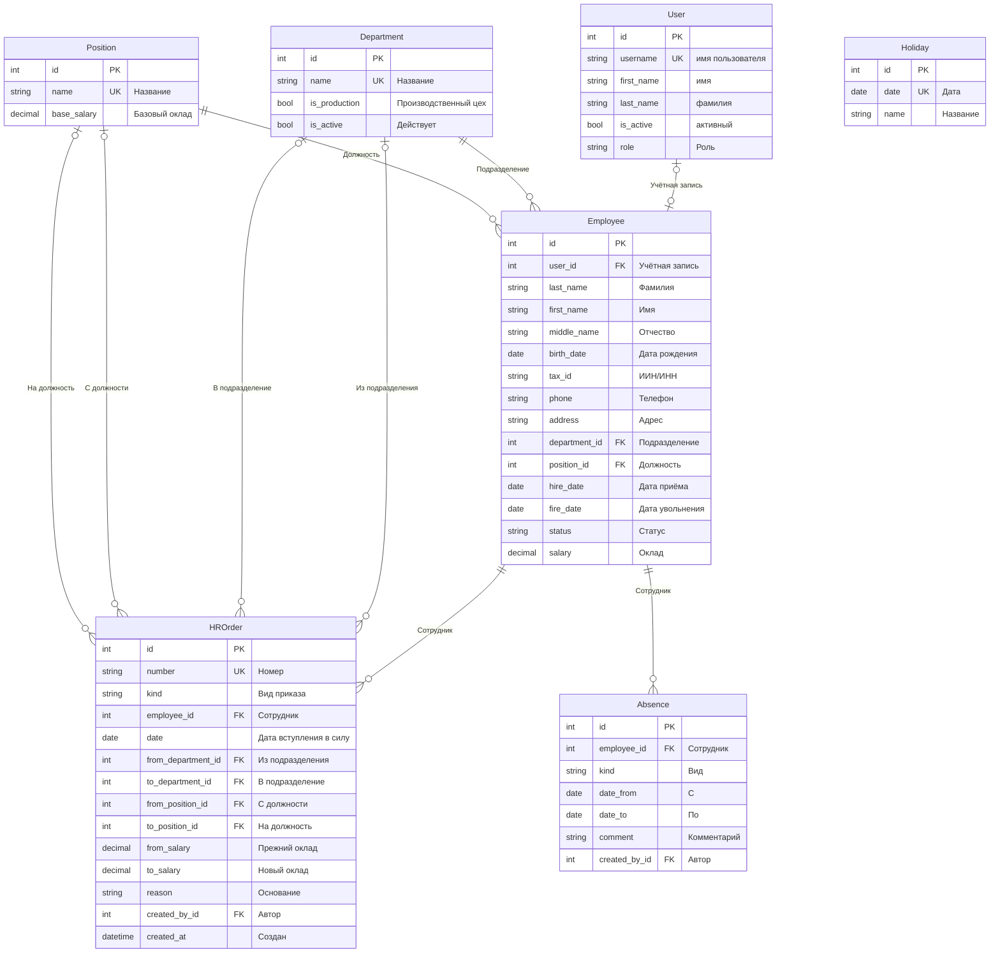
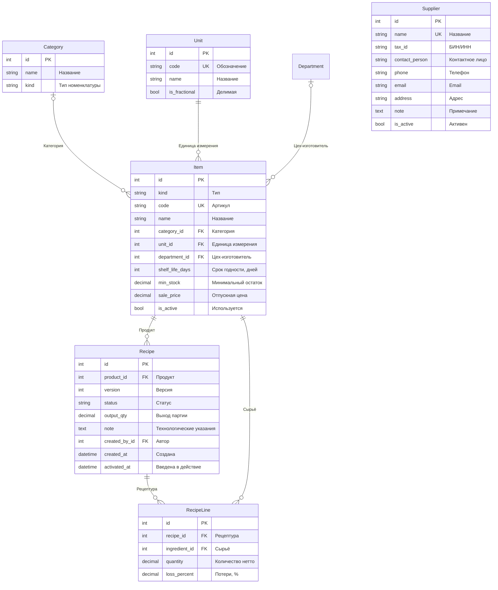
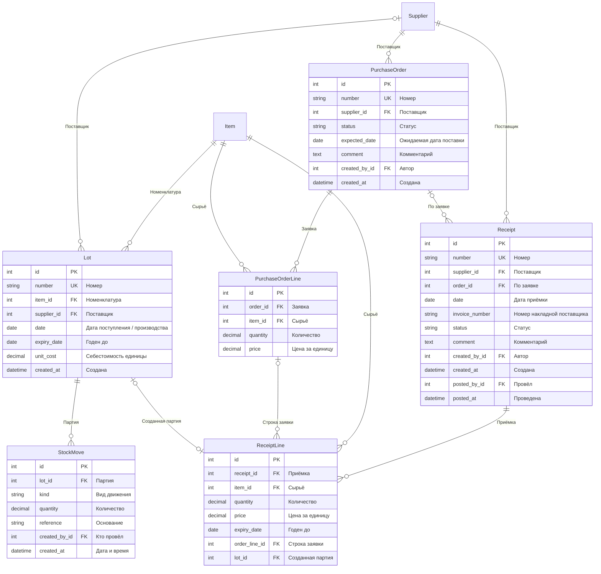
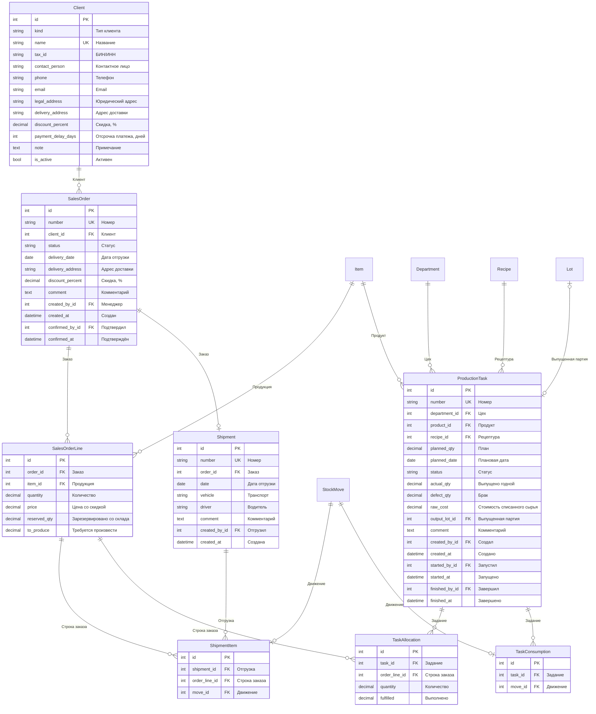
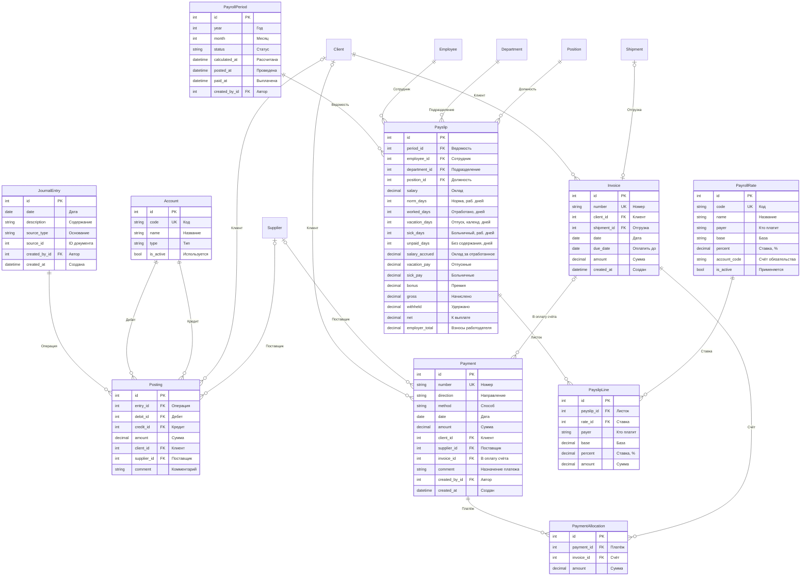

# ER-диаграммы

Сгенерировано из моделей Django: `python manage.py er_diagram --output docs/ER.md`.
Сущности из соседних доменов показаны без полей — только чтобы были видны связи между модулями.
Обозначения: `||--o{` — один ко многим, `||--o|` — один к одному, `|o` — связь необязательна (null).
Поля `created_by`, `posted_by` и т. п. — автор операции (связь с `User`); линиями не показаны, чтобы не загромождать схемы.

## Пользователи и кадры

`User` — Пользователь, `Department` — Подразделение, `Position` — Должность, `Employee` — Сотрудник, `HROrder` — Кадровый приказ, `Absence` — Отсутствие, `Holiday` — Праздничный день

## Каталог и рецептуры

`Unit` — Единица измерения, `Category` — Категория, `Item` — Номенклатура, `Supplier` — Поставщик, `Recipe` — Рецептура, `RecipeLine` — Строка рецептуры

Связи с другими доменами: Department.

## Склад и закупки

`Lot` — Партия, `StockMove` — Движение, `PurchaseOrder` — Заявка поставщику, `PurchaseOrderLine` — Строка заявки, `Receipt` — Приёмка, `ReceiptLine` — Строка приёмки

Связи с другими доменами: Item, Supplier.

## Продажи, отгрузка и производство

`Client` — Клиент, `SalesOrder` — Заказ клиента, `SalesOrderLine` — Строка заказа, `Shipment` — Отгрузка, `ShipmentItem` — Строка отгрузки, `ProductionTask` — Производственное задание, `TaskAllocation` — Распределение по заказу, `TaskConsumption` — Списание сырья

Связи с другими доменами: Department, Item, Lot, Recipe, StockMove.

## Бухгалтерия и зарплата

`Account` — Счёт, `JournalEntry` — Операция, `Posting` — Проводка, `Invoice` — Счёт покупателю, `Payment` — Платёж, `PaymentAllocation` — Разнесение платежа, `PayrollRate` — Ставка удержания / взноса, `PayrollPeriod` — Расчётная ведомость, `Payslip` — Расчётный листок, `PayslipLine` — Строка расчётного листка

Связи с другими доменами: Client, Department, Employee, Position, Shipment, Supplier.

